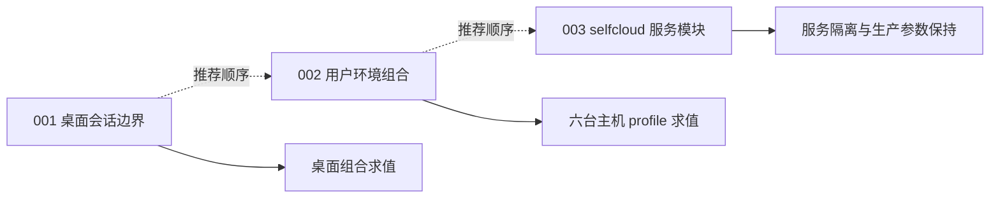

# 模块边界调整实施计划

由 improve 技能于 2026-11-11 编写，源码基线为 `1a695a3`。用户选择的范围为 Linux 桌面边界、跨平台用户配置组合，以及新增的 selfcloud 模块化。本目录记录实施计划及执行状态；001、002 已按维护者后续的明确指令实现。

每位执行者都应完整阅读自己负责的计划、核对工作区漂移、运行验证，再更新状态。计划均自包含，不要求先阅读对话。初次规划阶段没有自动执行；001、002 由当前代理在维护者明确要求实现后直接完成源码调整。

## 推荐执行顺序与状态

| Plan                             | 内容                                                             | Priority | Effort | 依赖 | 状态 |
| -------------------------------- | ---------------------------------------------------------------- | -------- | ------ | ---- | ---- |
| [001](001-desktop-boundaries.md) | 区分桌面共享配置与会话组件，处理 Noctalia/Qt 调色板关联          | P1       | M      | 无   | DONE |
| [002](002-home-profiles.md)      | minimal / developer / workstation 显式组合用户环境               | P1       | M      | 无   | DONE |
| [003](003-selfcloud-services.md) | 提取 Samba、Jellyfin、qBittorrent、Gitea，保留主机数据和硬件政策 | P1       | M      | 无   | TODO |

状态值：TODO、IN PROGRESS、DONE、BLOCKED（附原因）、REJECTED（附原因）。

### 001 执行记录（2026-11-11）

- 已实现 common 共享入口；Noctalia 与 gpu-screen-recorder 仅在 Niri 启用；hyprshot 移至 Hyprland；Qt5/Qt6 仅在 Noctalia 启用时读取其调色板路径。
- 新增 `tests/desktop-boundaries.nix`，四种 environment 的会话资源、应用、共享能力、Qt 设置及 Home Manager 激活 derivation 求值全部通过。命令：`nix eval --impure --offline --no-update-lock-file --json --expr 'import ./tests/desktop-boundaries.nix { flake = builtins.getFlake (toString ./.); }'`，输出 `{"gnome":true,"hyprland":true,"niri":true,"none":true}`。
- `just check-hosts` 通过，四台 NixOS 和两台 Darwin 均成功求值。
- 本次修改文件通过 `nixfmt --width=80 --check`、statix、deadnix；`git diff --check` 通过。
- `just check` 首次因 `home/public/shell/tuios/default.nix` 的格式失败；后续复查时文件已符合格式，`nixfmt --width=80 --check` 与完整 `just check` 均通过，001 已完成。
- 已有 Hyprland 默认壁纸引用指向空 assets 目录。测试 fixture 仅清空 Hyprland 的 exec-once，以排除壁纸启动命令后验证其他完整配置；没有修复或验证真实壁纸启动行为。
- 未切换系统、未测试实际图形登录。执行期间观察到 Noctalia 设置继续变化、`hosts/woxQAQ/configs/niri-hardware.kdl` 出现外部修改；均未触碰。Helix 与 tuios 文件内容哈希与执行开始时一致。

### 002 执行记录（2026-11-11）

- 已新增 minimal、developer、workstation 静态组合。selfcloud 选择 minimal，WSL 选择 developer，其余四台机器选择 workstation。
- 基础入口保留 CLI、Nix 维护工具与 npm/pnpm 发布时间策略；开发工具由 developer 选择；DBeaver 和媒体工具由 workstation 选择。终端默认不安装，workstation 默认 Kitty，主机现有 Ghostty 选择保留。
- 已将内部 `modules.public.desktop.enable` 及其全部调用者迁移为 `modules.public.zed.enable`，windows-vm1 显式保留 Zed 禁用。
- 四台工作站的用户软件包集合与执行前完全一致；WSL 只移除 dbeaver-bin、kitty、ffmpeg-full、imagemagick；selfcloud 移除开发工具链和 GUI，保留 Nix 维护、agents 自身依赖及原有 helix/tuios 禁用设置。
- 新增 `tests/home-profiles.nix`。六台真实主机、服务器叠加 developer、工作站默认值、终端列表强制清空，共九个完整 Home Manager 配置用例通过，包含激活 derivation 求值。命令：`nix eval --impure --offline --no-update-lock-file --json --expr 'import ./tests/home-profiles.nix { flake = builtins.getFlake (toString ./.); }'`。
- `just check-hosts`、完整 `just check`、001 的四种桌面回归测试及 `git diff --check` 均通过。
- 本次基线为 `66ae86e`，执行开始时工作区干净。改动仅涉及计划范围；未修改系统服务、磁盘、语言包版本、锁文件或其他主机偏好；未切换系统。

## 依赖与交付原则

三个计划的源码范围互不重叠，可以独立执行；推荐按 001 → 002 → 003 顺序审查，避免同时改变多类行为。002 会明确减少 selfcloud 的用户开发工具与 GUI 程序；003 的“行为保持”专指系统服务、存储和部署参数，不应将 002 的预期用户软件差异误判为 003 回归。

每个计划必须先建立自己的整套配置求值基线，再调整模块。测试属于模块组合集成测试，不是 helper 函数单测。每步的具体命令、期望结果和 STOP 条件见对应文件。

不运行 `nixos-rebuild switch`、`darwin-rebuild switch`，不运行磁盘格式化/挂载或数据迁移。只有操作者要求才提交、push 或创建 PR。

## 命名与职责决定

- **profile**：配置组合，负责选择哪些功能；使用静态 Nix imports，不新增 profile 枚举解释器。
- **minimal**：跨平台 CLI、主题和 Nix 配置维护基础；代理模块仍显式拥有自己的工具依赖。
- **developer**：在基础之上增加 CLI 开发工具，不自动安装 GUI。
- **workstation**：开发工具、GUI 应用和终端模拟器的工作站组合；保留主机现有应用选择。
- **services 模块**：可独立启用的系统服务策略；不拥有某台机器的 IP、共享路径、磁盘或硬件型号。
- 继续使用系统 `modules.desktop.environment` 选择会话；不增加第二套 Home Manager 会话开关。
- selfcloud 的 qBittorrent 继续使用 `qbittorrent-nox` 单元和既有 home profile。当前上游模块的单元名、ProtectHome 与 profile 约束不同，迁移需要另行设计。

## 现场验证与局限

本轮完成的只读检查：

- 四台 NixOS 主机 `system.build.toplevel.drvPath` 求值通过。
- 定向求值确认 selfcloud/WSL 当前启用 DBeaver、安装 Kitty；GNOME 的 windows-vm1 当前启用 Noctalia、安装 hyprshot。
- selfcloud 的服务、端口、qBittorrent 身份与依赖、Gitea state/database/LFS、资源预算已求值核对，具体基线写入 003。
- 已读取当前锁定 nixpkgs 的 qBittorrent 上游模块，确认其 home profile 限制。

尚未完成的验证：Darwin 全主机求值在一次 60 秒窗口内未完成；`just check` 未运行；计划中的新增测试尚未实现；未构建或激活系统、未测试图形登录或 NAS/媒体服务的实际访问。不要把这些项目标成通过。

执行者标准入口为 `just check-hosts`、`just check` 与各计划新增的独立测试命令。Nix Git flake 不包含全新未跟踪文件，执行时需让新源码进入 Git 可见范围；不可因此暂存用户的无关修改。

## 用户已有修改

本轮开始时存在：

- `home/public/helix/default.nix`
- `hosts/woxQAQ/configs/noctalia-settings.toml`

编写期间又观察到 `home/public/shell/tuios/default.nix` 的修改。以上均非本轮创建或编辑；执行前重新记录当前完整 dirty 集合，并保留所有既有 diff。基线 SHA 不能代替工作区漂移检查。

## 已考虑并排除的方向

- **把所有 osConfig 依赖都删除**：不做。游戏配置复用系统 Steam 包有实际需要；会话选择也需要唯一事实来源。
- **给每个包新增 enable 开关**：不做。优先通过少量组合与功能模块表达意图，避免开关数量膨胀。
- **只移动文件、不处理行为依赖**：不接受。例如关闭 Noctalia 必须同时解除公共 Qt 对其调色板文件的引用。
- **把 selfcloud 所有文件都上提成通用模块**：不做。RAID/LVM、UUID 挂载、ACL、bfq、资源预算、硬件加速、地址与数据路径都属于机器部署。
- **本次直接改用上游 qBittorrent 服务**：不做。涉及现有 profile 与单元行为迁移，超出职责拆分范围。
- **清理未被引用的 fx-settings.json 或空 home.nix**：收益低，与服务模块化无关，保留。

## 后续候选，未选为本次实施计划

- 硬件模块明确 Intel/AMD 范围，拆开硬件能力与个人工具集合。
- 将沙箱应用的包定义归入统一的软件包装配入口，解除 Home 桌面对系统 overlay 导入的隐式要求。
- 按诊断功能组织 Linux packages，聚合相关权限。

这些候选仍需各自定义行为基线与范围，本轮不让执行者顺手处理。
